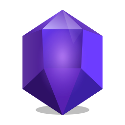
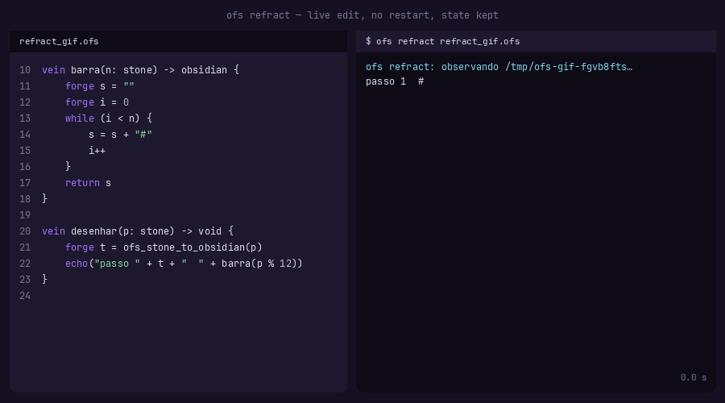

<div align="center">
  

  # Obsidian Fault Script

  **Un lenguaje para sistemas, UI, web y Android. Cambia el código mientras corre.**

  [English](README.md) · [Português](README.pt-BR.md) · [Español](README.es.md)

  [](https://github.com/Samwns/Obsidian-Fault-Script/actions/workflows/build.yml)
  [](https://samwns.github.io/Obsidian-Fault-Script/docs/)
  [](https://github.com/Samwns/Obsidian-Fault-Script/releases/latest)
  [](LICENSE)
  [](docs/COMPILER_ARCHITECTURE.md)
  [](https://ko-fi.com/samwns)

  [**Official Site**](https://samwns.github.io/Obsidian-Fault-Script/docs/)
  · [**Documentation**](https://samwns.github.io/Obsidian-Fault-Script/docs/ref/index.html)
  · [**Downloads**](https://github.com/Samwns/Obsidian-Fault-Script/releases/latest)
  · [**Benchmark**](https://samwns.github.io/Obsidian-Fault-Script/docs/benchmark.html)
  · [**Trademark Policy**](TRADEMARK.md)
  · [**Sponsor / Apoiar**](https://ko-fi.com/samwns)
</div>

<br>

## OFS 2.0: edita código nativo mientras corre

<p align="center">
  
</p>

*`ofs refract` en una grabación real: tres guardados, tres cambios en vivo, y el contador `passo` sigue contando. Sin reiniciar, sin perder el estado.*

La mayoría de los lenguajes nativos te obligan a elegir entre control de bajo nivel y un flujo de trabajo rápido y cómodo. OFS te da ambos en el mismo programa.

### Qué hace distinto a OFS

- **Un lenguaje, todas las superficies.** Sistemas, UI, web y Android con la misma sintaxis. Sin runtime pesado: un programa vacío es un binario de ~42 KB ([cifras](docs/PERFORMANCE.md)).
- **Alto y bajo nivel en el mismo programa.** Control de bajo nivel, de sistema, donde lo necesitas; la seguridad crece por capas con `stratum`/`claim` por archivo y bloques explícitos `fracture`/`abyss`.
- **Interpretado y compilado, con la misma semántica.** Por eso el código cambia con el programa corriendo (**Fault Refract**, también en el móvil), `ofs run` cristaliza solo el código caliente (en el benchmark `loop` queda a cerca de un 16% de C -O2; [ver el benchmark](bench/RESULTADOS.md)) y puedes grabar una ejecución y volver atrás en el tiempo (`ofs fossil`).
- **Autoalojado.** El compilador está escrito en el propio OFS.
- **Una sola herramienta.** Compilar, ejecutar, probar, formatear, documentar y gestionar paquetes con `ofs`. Sin herramientas externas de build.

### Lo destacado de 2.0

- **Edición en vivo** con `ofs refract`: guarda el archivo y las veins cambiadas entran en su lugar, con el estado intacto. [Guía](docs/es/GETTING_STARTED.md)
- **Cristalización y OSR:** las veins calientes y los bucles activos pasan a código nativo en segundo plano. [Rendimiento](docs/PERFORMANCE.md)
- **Contratos:** `mineral`, `grain`, `bearing`, `settle` y `ofs assay` detectan valores malos pronto. [Referencia](docs/es/LANGUAGE_REFERENCE.md)
- **Arena y `geode`:** `bedrock { }` libera de una vez lo que reserva; closures por valor.
- **Seguridad gradual:** `stratum crust|fault|abyss` por archivo.
- **`magma.cast`:** carga y ejecuta OFS en ejecución. **`ofs fossil`:** graba y vuelve atrás en el tiempo. **`ofs quarry`:** paquetes.
- **`quartz`** (ensamblador en línea), Rift en el intérprete y **apps Android compiladas en Windows**.

Lista completa en el [changelog](docs/es/CHANGELOG.md).

### Empezar

```sh
# instala desde la última release: https://github.com/Samwns/Obsidian-Fault-Script/releases/latest
ofs run app.ofs        # ejecuta (el código caliente se cristaliza solo a nativo)
ofs refract app.ofs    # ejecuta y aplica cada guardado en vivo, sin reiniciar
ofs build app.ofs -o app   # compila un binario nativo
```

<br>

<div align="center">
  <a href="https://ko-fi.com/samwns" target="_blank" rel="noopener noreferrer">
    
  </a>
</div>
