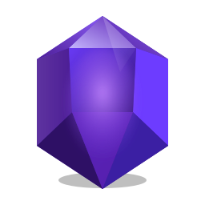

<div align="center">
  

  # Obsidian Fault Script

  **A self-hosted compiled language for native programs and the Web.**

  [](https://github.com/Samwns/Obsidian-Fault-Script/actions/workflows/build.yml)
  [](https://samwns.github.io/Obsidian-Fault-Script/docs/)
  [](https://github.com/Samwns/Obsidian-Fault-Script/releases/latest)
  [](LICENSE)
  [](docs/COMPILER_ARCHITECTURE.md)
  [](https://ko-fi.com/samwns)

  [**Official Site**](https://samwns.github.io/Obsidian-Fault-Script/docs/)
  · [**Documentation**](https://samwns.github.io/Obsidian-Fault-Script/docs/getting-started.html)
  · [**Downloads**](https://github.com/Samwns/Obsidian-Fault-Script/releases/latest)
  · [**Benchmark**](https://samwns.github.io/Obsidian-Fault-Script/docs/benchmark.html)
  · [**Trademark Policy**](TRADEMARK.md)
  · [**Sponsor / Apoiar**](https://ko-fi.com/samwns)
</div>

<br>

<div align="center">
  <a href="https://ko-fi.com/samwns" target="_blank" rel="noopener noreferrer">
    
  </a>
</div>

## Android (aarch64) e OAL

O OFS também gera APKs para Android (aarch64):

```sh
ofs build --target android app.oal -o app-debug.apk
```

- **APK 100% OFS:** sem Java e sem C no código do app. O `NativeActivity` é exportado por `android.ofs`, e a chamada à API do Android (JNI) sai de `fault_addr`/`fault_call`.
- **OAL (Obsidian Android Language, `.oal`):** sub-linguagem que descreve o que é próprio do Android: manifesto, telas de toque, estilos, ações e ciclo de vida. A lógica continua em `.ofs`. Ela é irmã da ODL, da OES e da OLL.
- **Exemplo real:** o [M.O.O.N](Moon/README.md), um executor de visual novels para Android escrito inteiramente em OFS, com a interface em OAL.

Documentação:
- [docs/ANDROID.md](docs/ANDROID.md): requisitos, build, instalação e como o app roda.
- [docs/OAL_REFERENCE.md](docs/OAL_REFERENCE.md): referência da OAL v1.