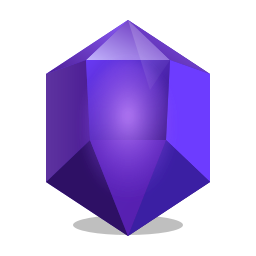
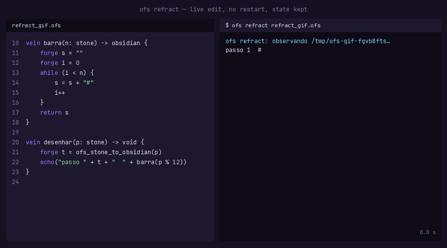

<div align="center">
  

  # Obsidian Fault Script

  **One language for systems, UI, web and Android. Change it while it runs.**

  [English](README.md) · [Português](README.pt-BR.md) · [Español](README.es.md)

  [](https://github.com/Samwns/Obsidian-Fault-Script/actions/workflows/build.yml)
  [](https://samwns.github.io/Obsidian-Fault-Script/docs/)
  [](https://github.com/Samwns/Obsidian-Fault-Script/releases/latest)
  [](LICENSE)
  [](docs/COMPILER_ARCHITECTURE.md)
  [](https://ko-fi.com/samwns)

  [**Official Site**](https://samwns.github.io/Obsidian-Fault-Script/docs/)
  · [**Documentation**](https://samwns.github.io/Obsidian-Fault-Script/docs/ref/index.html)
  · [**Downloads**](https://github.com/Samwns/Obsidian-Fault-Script/releases/latest)
  · [**Benchmark**](https://samwns.github.io/Obsidian-Fault-Script/docs/benchmark.html)
  · [**Trademark Policy**](TRADEMARK.md)
  · [**Sponsor / Apoiar**](https://ko-fi.com/samwns)
</div>

<br>

## OFS 2.0: edit native code while it runs

<p align="center">
  
</p>

*`ofs refract` in a real recording: three saves, three live swaps, and the `passo` counter keeps counting. No restart, no lost state.*

Most native languages make you choose between low-level control and a fast, friendly workflow. OFS gives you both in one program.

### What makes OFS different

- **One language, every surface.** Systems code, UI, web and Android with the same syntax. No heavy runtime: an empty program is a ~42 KB binary ([numbers](docs/en/PERFORMANCE.md)).
- **High and low level in the same program.** Take systems-level control where you need it; safety grows in layers with `stratum`/`claim` per file and explicit `fracture`/`abyss` blocks.
- **Interpreted and compiled, same semantics.** That is why the code can change while the program runs (**Fault Refract**, also on a phone), why `ofs run` crystallizes hot code by itself (the `loop` benchmark runs within about 16% of C -O2; [see the benchmark](bench/RESULTADOS.md)), and why you can record a run and travel back in time (`ofs fossil`).
- **Self-hosted.** The compiler is written in OFS itself.
- **One tool.** Build, run, test, format, document and manage packages with `ofs`. No external build tools.

### Highlights of 2.0

- **Live editing** with `ofs refract`: save a file and the changed veins swap in, state preserved. [Guide](docs/en/GETTING_STARTED.md)
- **Crystallization and OSR:** hot veins and running loops become native code in the background. [Performance](docs/en/PERFORMANCE.md)
- **Contracts:** `mineral`, `grain`, `bearing`, `settle` and `ofs assay` catch bad values early. [Reference](docs/en/LANGUAGE_REFERENCE.md)
- **Arena and `geode`:** `bedrock { }` frees what it allocates in one go; closures by value.
- **Gradual safety:** `stratum crust|fault|abyss` per file.
- **`magma.cast`:** load and run OFS at runtime. **`ofs fossil`:** record and travel back in time. **`ofs quarry`:** packages.
- **`quartz`** inline assembly, Rift in the interpreter, and **Android apps built from Windows**.

Full list in the [changelog](docs/en/CHANGELOG.md).

### Get started

```sh
# install from the latest release: https://github.com/Samwns/Obsidian-Fault-Script/releases/latest
ofs run app.ofs        # run it (hot code crystallizes to native on its own)
ofs refract app.ofs    # run it and apply every save live, without restarting
ofs build app.ofs -o app   # compile a native binary
```

<br>

<div align="center">
  <a href="https://ko-fi.com/samwns" target="_blank" rel="noopener noreferrer">
    
  </a>
</div>
