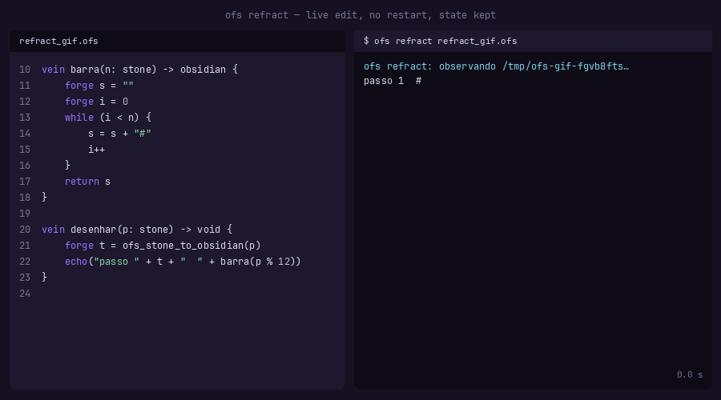

<div align="center">
  

  # Obsidian Fault Script

  **Uma linguagem para sistema, UI, web e Android. Mude o código enquanto ele roda.**

  [English](README.md) · [Português](README.pt-BR.md) · [Español](README.es.md)

  [](https://github.com/Samwns/Obsidian-Fault-Script/actions/workflows/build.yml)
  [](https://samwns.github.io/Obsidian-Fault-Script/docs/)
  [](https://github.com/Samwns/Obsidian-Fault-Script/releases/latest)
  [](LICENSE)
  [](docs/COMPILER_ARCHITECTURE.md)
  [](https://ko-fi.com/samwns)

  [**Official Site**](https://samwns.github.io/Obsidian-Fault-Script/docs/)
  · [**Documentation**](https://samwns.github.io/Obsidian-Fault-Script/docs/ref/index.html)
  · [**Downloads**](https://github.com/Samwns/Obsidian-Fault-Script/releases/latest)
  · [**Benchmark**](https://samwns.github.io/Obsidian-Fault-Script/docs/benchmark.html)
  · [**Trademark Policy**](TRADEMARK.md)
  · [**Sponsor / Apoiar**](https://ko-fi.com/samwns)
</div>

<br>

## OFS 2.0: edite código nativo com o programa rodando

<p align="center">
  
</p>

*`ofs refract` numa gravação real: três salvamentos, três trocas ao vivo, e o contador `passo` segue contando. Sem reiniciar, sem perder o estado.*

A maioria das linguagens nativas obriga a escolher entre controle de baixo nível e um fluxo de trabalho rápido e agradável. O OFS entrega os dois no mesmo programa.

### O que o OFS faz de diferente

- **Uma linguagem, todas as superfícies.** Sistema, UI, web e Android com a mesma sintaxe. Sem runtime pesado: um programa vazio é um binário de ~42 KB ([números](docs/PERFORMANCE.md)).
- **Alto e baixo nível no mesmo programa.** Controle de baixo nível, de sistema, onde você precisa; a segurança cresce em camadas com `stratum`/`claim` por arquivo e blocos explícitos `fracture`/`abyss`.
- **Interpretado e compilado, com a mesma semântica.** Por isso o código muda com o programa rodando (**Fault Refract**, inclusive no celular), o `ofs run` cristaliza o código quente sozinho (no benchmark `loop` fica a cerca de 16% do C -O2; [veja o benchmark](bench/RESULTADOS.md)) e dá para gravar uma execução e voltar no tempo (`ofs fossil`).
- **Self-hosted.** O compilador é escrito no próprio OFS.
- **Uma ferramenta só.** Compilar, rodar, testar, formatar, documentar e gerenciar pacotes com o `ofs`. Sem ferramentas externas de build.

### Destaques da 2.0

- **Edição ao vivo** com `ofs refract`: salve o arquivo e as veins alteradas entram no lugar, com o estado preservado. [Guia](docs/GETTING_STARTED.md)
- **Cristalização e OSR:** veins quentes e laços em execução viram código nativo em segundo plano. [Desempenho](docs/PERFORMANCE.md)
- **Contratos:** `mineral`, `grain`, `bearing`, `settle` e `ofs assay` pegam valores ruins cedo. [Referência](docs/LANGUAGE_REFERENCE.md)
- **Arena e `geode`:** `bedrock { }` libera de uma vez o que aloca; closures por valor.
- **Segurança gradual:** `stratum crust|fault|abyss` por arquivo.
- **`magma.cast`:** carrega e roda OFS em execução. **`ofs fossil`:** grava e volta no tempo. **`ofs quarry`:** pacotes.
- **`quartz`** (assembly inline), Rift no interpretador e **apps Android compilados no Windows**.

Lista completa no [changelog](docs/CHANGELOG.md).

### Começar

```sh
# instale pela última release: https://github.com/Samwns/Obsidian-Fault-Script/releases/latest
ofs run app.ofs        # roda (o código quente cristaliza sozinho para nativo)
ofs refract app.ofs    # roda e aplica cada salvamento ao vivo, sem reiniciar
ofs build app.ofs -o app   # compila um binário nativo
```

<br>

<div align="center">
  <a href="https://ko-fi.com/samwns" target="_blank" rel="noopener noreferrer">
    
  </a>
</div>
